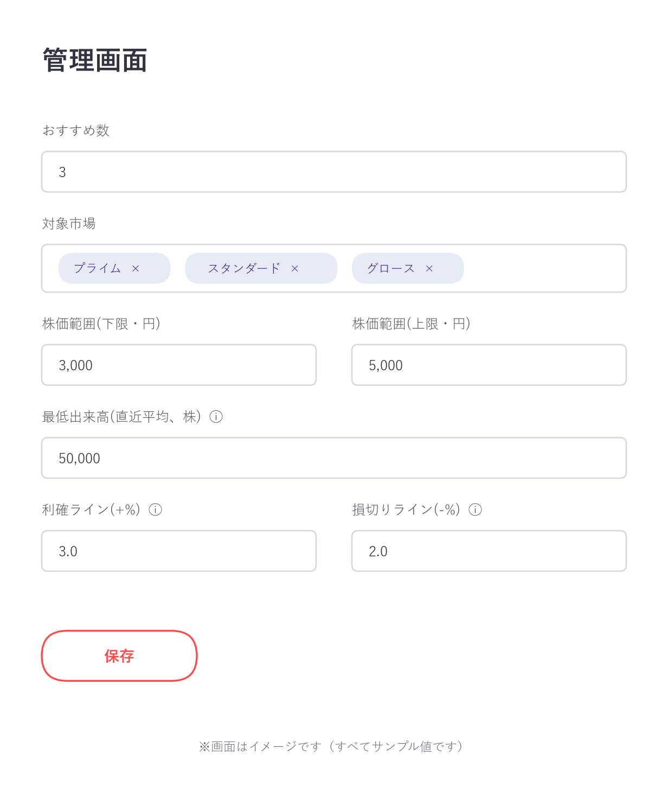

# 「デイトレAIおすすめ株ナビ」の入手・公開ガイド＆Claude Codeカスタマイズ手順

※タイトル案（他の候補は本ファイル末尾の「題名案」を参照）

（冒頭に目次を箇条書きで入れる。note上でリンクジャンプしない場合がある旨も注記）

- 1. はじめに（無料エリア）
- 2. 仕組みの全体像
- 3. 【セットアップ】自分専用アプリとして公開する手順
- 4. 【応用】Claude Codeで自分好みに改造する手順
- 5. よくあるエラーとトラブルシューティング
- 6. 免責事項・注意事項

---

## 1. はじめに（無料公開エリア）

毎朝、自分で東証の銘柄を1つずつスクリーニングしてから出社する――。デイトレに興味があっても、
これを仕事の前にやるのは現実的ではありません。この記事で紹介するのは、**毎朝7:00に「直近
値上がりしている銘柄」を機械的に絞り込み、最後にAI（Claude）が候補を見比べて最終選定し、
順位と理由付きでスマホに表示してくれるWebアプリ**の作り方です。


※画面はイメージです（すべてサンプルデータ・実際の選定結果ではありません）


※画面はイメージです（すべてサンプル値です）

毎朝アプリを開くと、このように順位・前日終値・利確/損切りの目安・AIによる選定理由が
一覧表示され、過去のおすすめの結果履歴や月次・年次の勝率もあわせて確認できます。

> **「AI」という言葉について**: このアプリは2段階構成です。①まず直近の値上がり率・出来高の
> 急増度・移動平均線・RSIといった株価データをもとに、ルールベースの計算式で数千銘柄から
> 候補を十数〜数十件まで機械的に絞り込みます。②そのうえで、**実際にAnthropicのClaude（Sonnet 5.5）
> が候補データだけを見て最終的な順位と選定理由を生成**します。②の段階で初めてAI（大規模言語
> モデル）のAPIを呼び出すため、ここでは実際にトークン課金が発生します（詳しくは後述の
> 「必要なもの」参照。1日1回・候補データのみの軽い呼び出しのため、月あたりの金額は数百円程度に
> 収まる想定です）。AIには**候補の数値データのみ**を渡し、ニュースや決算予想などの外部情報は
> 与えません。これは、AIが与えられていない情報を創作してしまう（ハルシネーション）リスクを
> 抑え、「将来の株価を予測する」のではなく「直近の値動き傾向を解釈して並べ替える」という
> 位置づけを崩さないための設計です。

### このアプリでできること

- 毎朝7:00（自動実行）に、東証プライム・スタンダード・グロースの中から、直近5営業日の値上がり
  率（モメンタム）と出来高の急増度で機械的に候補を絞り込み
- その候補をAI（Claude）が見比べて、**最終的な「おすすめ銘柄」を1〜5位まで、選定理由つき**で表示
- 各銘柄の前日終値・利確目安（+X%）・損切り目安（−Y%）も合わせて表示
- 過去のおすすめが実際に値上がりしたかどうかの**結果履歴・月次勝率**を自動集計
- 管理画面から、おすすめ件数・対象市場・株価帯・最低出来高・利確損切り%を自分の好みに調整可能
- スマホのブラウザからパスワードでログインして確認するだけ（ホーム画面への追加も可能）
- AIの呼び出しに失敗した場合は、自動的に①の機械的な絞り込みだけでおすすめを決定（その日の
  おすすめが止まらない設計）

### この記事に含まれるもの

- アプリ本体のソースコード一式（Python / Streamlit）
- 自分専用に複製して公開するための手順書（この記事そのもの）
- つまずきやすいポイントと実際の解決策
- Claude Codeで自分好みに改造するためのプロンプト例

### 必要なもの

- **GitHubアカウント**（ソースコードの置き場・自動実行の仕組み）: 無料
- **Supabaseアカウント**（データの保存：設定・おすすめ履歴）: 無料プランで十分
- **J-Quants API（Freeプラン）**（銘柄の市場区分〈プライム/スタンダード/グロース〉取得）: 無料
- **Streamlit Community Cloud**（アプリ本体のホスティング）: 無料
- **cron-job.org等の外部cronサービス**（毎朝決まった時刻にアプリを起動させる）: 無料プランで十分
- **Anthropicアカウント＋APIキー**（AIによる最終選定、毎朝1回の呼び出し）: **従量課金**。
  Anthropicコンソールでクレジットカード登録とチャージが必要です。目安は下記のとおりです
- （任意）**Claude Code**（4章の「自分好みに改造する」を行う場合のみ必要）: Claude Codeの
  利用料（Claude Pro/Maxなどのサブスクプラン、または上記とは別枠の従量課金）。改造しないなら不要です

株価・出来高データ自体はYahoo Finance（yfinance、無料・登録不要）から取得するため、証券会社の
口座やAPIは**この記事の範囲では不要**です（実際に売買する場合は、お使いの証券会社で行ってください）。

> **AI選定のコスト目安**: 1日1回、量的フィルタ後の候補（上位20件程度）の数値データだけを
> Claude Sonnet 5.5に渡して選ばせる設計のため、1回あたりのやり取りはごく小さく、**月あたり
> 数百円程度に収まる想定です**（2026年11月時点のAnthropic公開レート・候補20件・平日のみ稼働を
> 前提にした試算。実際の金額は候補数や相場状況により変動するため、Anthropicコンソールの
> 利用状況画面で確認してください）。ANTHROPIC_API_KEYを設定しない場合は、AIを使わず①の
> 機械的な絞り込みだけで動作します（コストはゼロになります）。
>
> **Claude Codeのサブスクとは別物です。** Claude Pro/Maxに加入していても、このアプリ用には
> 別途Anthropicコンソールで従量課金のAPIキーを発行し、支払い方法を登録する必要があります。
> 逆に、AI選定機能だけを使い、4章のカスタマイズ（Claude Code）はしない場合は、Claude Pro/Max等の
> サブスクは不要です。

### 作業時間の目安

- **各種アカウント登録**（GitHub・Supabase・J-Quants・Anthropic・Streamlit・cron-job.org）: 30分
- **リポジトリの複製・Supabaseテーブル作成**: 20分
- **ローカルでの動作確認**（Git・Pythonのインストールが初めての場合を含む）: 20〜40分
- **デプロイ・環境変数設定**: 30分
- **cron設定・動作確認**: 20分
- **合計**: **2〜2.5時間程度**（Git・Pythonを既にお使いの場合は1.5〜2時間程度）

Supabase・J-Quants・Streamlit Community Cloudそれぞれの実際の操作画面、コピーしてそのまま使える
コマンドや設定値、そして実際につまずきやすかったポイントとその解決策まで、すべてこの記事の中だけで
完結するように書いています。

> **投資は自己責任です。** このアプリは「直近の値動き・出来高をもとにした順張りの機械的な
> 絞り込み」と「そのデータだけを根拠にしたAIによる解釈・並べ替え」を行うツールであり、将来の
> 株価を予測するものではありません。このアプリの表示やこの記事の内容によって利益が出ることを
> 保証するものではなく、投資判断とその結果についてはすべてご自身の責任で行ってください。

---

ここから先は有料エリアです。GitHubアカウントの作り方から、Supabase・J-Quants・Anthropicの
設定画面、実際に貼り付けて使えるコマンド、つまずきポイントの解決策まで、順を追って説明します。

（ここから有料エリア）

## 2. 仕組みの全体像

毎朝、次の順番で自動的に動きます。

1. **7:00** — GitHub Actionsが起動し、`scripts/fetch_and_recommend.py` を実行
2. J-Quants APIから上場銘柄一覧（市場区分つき）を取得し、株価帯・最低出来高の条件で候補を絞り込み
3. yfinanceで候補銘柄の値動き・出来高を取得し、「直近5営業日の値上がり率」と「出来高の急増度」を
   合算したスコアを算出（5日移動平均＞20日移動平均＝上昇トレンドの銘柄のみ／RSI14が70以上＝
   買われすぎの銘柄は除外）。この時点でスコア上位20件程度まで絞り込む
4. **スコア上位の候補（数値データのみ）をClaude（Sonnet 5.5）に渡し、設定件数ぶんの最終順位と
   選定理由を生成させる**（候補に無いティッカーが返ってきた場合やAPI呼び出しが失敗した場合は、
   手順3のスコア順そのままにフォールバックする）
5. 結果をSupabaseの`recommendations`テーブルに保存（どちらの方式で選ばれたかも記録）
6. ユーザーはスマホでWebアプリを開き、本日のおすすめと選定理由を確認
7. 翌営業日の朝（6:50頃）、`scripts/update_results.py` が前日のおすすめ銘柄の終値を確定し、
   「実際に何%動いたか」を結果履歴に記録

GitHub Actions自体の`schedule`（内蔵cron）は使っていません。個人リポジトリでは指定時刻から
数時間〜半日単位で実行がずれることが実際に確認されており、「8:30までに確認したい」という
要件を満たせなかったためです。代わりに、外部のcronサービス（cron-job.org等）からGitHubの
REST APIを指定時刻に呼び出す方式にすることで、指定時刻に近いタイミングでの実行を実現しています。

## 3. 【セットアップ】自分専用アプリとして公開する手順

### ① GitHubアカウントを作る

すでにお持ちの方はこの手順は不要です。ログインして②の手順に進んでください。

1. パソコンかスマホのブラウザで[https://github.com/signup](https://github.com/signup)を開きます
2. メールアドレス・パスワード・ユーザー名を入力します。ユーザー名は公開URLの一部になります
   （例：ユーザー名が`taro`なら、あとで`https://taro.github.io/...`になります）。半角英数字と
   ハイフンのみです
3. 表示される簡単なクイズ（人間確認）に答えます
4. 届いた確認メールのコードを入力すれば完了です
5. プラン選択を聞かれたら「Free」で問題ありません

### ② 公開用リポジトリを複製する

公開用リポジトリ: [https://github.com/basel5freedom/ai-stock](https://github.com/basel5freedom/ai-stock)

1. 上記リポジトリのページを開くと、画面右上あたりに「Fork」というボタンがあります。これを押すと、
   そのコードがまるごと自分のGitHubアカウントにコピーされます（元のリポジトリは変更されません。
   「コピーを自分の持ち物にする」操作だとイメージしてください）
2. 確認画面が出たらそのまま「Create fork」を押します。数秒で、自分のアカウント名の下に
   同じ名前のリポジトリが出来上がります（これ以降の手順では、元のリポジトリではなく、この
   自分のアカウント名がついたリポジトリの方を使います）

### ③ Supabaseでデータベースを作る

Supabaseは、このアプリが「今日のおすすめ銘柄」や「設定」を保存しておくためのデータベース
サービスです。難しい設定は不要で、画面の指示に沿って進めれば数分で使えます。

1. [https://supabase.com](https://supabase.com)を開き、「Start your project」→GitHubアカウントで
   サインインします
2. ダッシュボードで「New project」を押します
3. 初回は組織（Organization）の作成を求められます。名前は`personal`などでOK、プランは
   Freeを選びます
4. プロジェクトの設定を入力します
   - **GitHub (optional)**：接続不要です
   - **Project name**：`stock-app`など任意
   - **Database Password**：「Generate a password」で生成します。この記事の手順
     （SQLエディタ・ブラウザ認証でのデプロイ）では使いませんが、将来データベースに直接
     つなぐときに必要になるので、控えておくと安心です
   - **Region**：都市名ではなく`Auto`・`Americas`・`Europe`・`Asia-Pacific`の4択です。
     `Auto`または`Asia-Pacific`を選択してください
   - **Data access**：チェックボックスが3つあります。次のようにします
     - **Enable Data API**（初期：ON）→ ONのまま（変更しない）。アプリはこのAPI経由で
       データベースにアクセスするため、OFFにすると画面が一切動きません
     - **Grant API access to new tables automatically**（初期：OFF）→ **ONにしてください**。
       OFFのままだと、次の手順で作るテーブルがAPI経由でまったく公開されず、アプリが
       データを読み書きできません
     - **Enable RLS on new tables automatically**（初期：OFF）→ **OFFのまま（ONにしないでください）**。
       このアプリのSQL（次の手順で流す`supabase_schema.sql`）は、テーブルに行レベル
       セキュリティ（RLS）をかけない前提で書かれています。ここをONにすると、新しく
       作ったテーブルに自動でRLSがかかり、ポリシー（許可ルール）が1つも無い状態になるため、
       後述の`anon public`キーからの読み書きがすべて拒否され、アプリが動かなくなります
   - 一番下の「ADVANCED CONFIGURATION」は開かなくて大丈夫です
5. 「Create new project」を押します。2分ほどで準備完了です
6. プロジェクトが出来たら、画面左側の縦に並んだアイコンの中から「SQL Editor」を選びます
   （虫眼鏡アイコンの少し下、四角いアイコンです。画面上部に検索欄がある場合はそこに
   「SQL Editor」と入力して探しても見つかります）
7. 「SQL Editor」を開くと、最初から空白のSQL入力欄が表示されています。ここに、②でForkした
   自分のリポジトリの中身を貼り付けます
   - 別のタブで、②でForkした自分のリポジトリ（`https://github.com/（あなたのGitHubユーザー名）/ai-stock`）
     を開きます
   - ファイル一覧の中から`supabase_schema.sql`を探してクリックします（リポジトリの直下にあります）
   - ファイルの中身が表示されたら、その中身をドラッグしてすべて選択し、Ctrl+C（Macは⌘+C）で
     コピーします（「Copy raw file」はファイルがダウンロードされてしまうので使いません）
   - Supabaseのタブに戻り、空白のSQL入力欄にCtrl+V（Macは⌘+V）で貼り付けます
   - 貼り付けたら右下（または画面上部）の「Run」ボタンを押します
   - 「Cancel」「Run without RLS」「Run and enable RLS」という3つのボタンが出た場合は、
     **「Run without RLS」**を選んでください（前の手順で説明したとおり、このアプリのテーブルは
     RLSをかけない前提で作られています）。これで`settings`・`recommendations`・`results`の
     3テーブルが作成されます（`recommendations`にはAI選定の理由を保存する`ai_reason`列、
     どちらの方式で選ばれたかを記録する`selection_method`列も含まれています）。「Success」等の
     メッセージが出れば完了です
8. 画面左下の歯車アイコン（「Project Settings」）を開き、次の2箇所をメモ帳などに
   控えておいてください（環境変数`SUPABASE_URL` / `SUPABASE_KEY`に使います）
   - 左メニューの「INTEGRATIONS」欄にある**「Data API」**を開き、「API URL」に表示されている
     文字列（`https://xxxxx.supabase.co/rest/v1/`の形）の、末尾の`/rest/v1/`を除いた部分
     （`https://xxxxx.supabase.co`）をコピーします。これが`SUPABASE_URL`です
   - 「Project Settings」→**「API Keys」**を開き、「Publishable key」の欄に
     表示されている`sb_publishable_`から始まる文字列をコピーします。これが`SUPABASE_KEY`です。
     **「Secret keys」欄の`sb_secret_`から始まるキーは使いません**。こちらは権限が強く、
     外部に漏らすと危険なためです

### ④ J-Quants APIキーを取得する

1. [J-Quants](https://jpx-jquants.com/)を開き、プラン一覧の中から**Free**プランの
   「無料で始める」を押します
2. ユーザー登録画面で、メールアドレス・パスワード・パスワード確認を入力し、
   「個人情報の取扱いに同意して、サインアップします。」にチェックを入れて「サインアップ」を
   押します
3. 登録したメールアドレスに確認コードが届きます。「メールアドレスを確認」画面に確認コードを
   入力し、「確認」を押します
4. 「MFA設定が必要です」という画面が出ます。「メールアドレスによるOTP」（ログイン時に
   メールアドレスへ届く確認コードを使う方式）を選んだまま「設定する」を押します
   （Google Authenticatorなどの認証アプリをお持ちの場合は「認証アプリによるMFA」でも構いません）
5. ダッシュボードに移動したら、画面左のメニューから**「API Keys」**をクリックします。
   まだプランを選んでいないため、代わりにプラン選択画面（「あなたに合ったプランを
   選択しましょう」）が表示されます。ここでFreeプランの「無料で登録」を押します
6. 連絡先情報・請求詳細の入力画面が出ます（Freeプランで料金は¥0ですが、入力は必要です）。
   国名で「日本」を選び、住所等を入力し、「株式会社JPX総研の利用規約およびプライバシーポリシーに
   同意します。」にチェックを入れて「登録」を押します
7. 登録が完了すると、ダッシュボードの「Subscription」画面でFreeプランが「ご利用中」と
   表示されます
8. 画面左のメニューから改めて**「API Keys」**を開きます（今度はAPI Keyの管理画面が
   表示されます）。**「API Keyを発行」**ボタンを押します。
   発行されたAPI Keyを「コピー」ボタンでコピーし、後で使うのでメモ帳などに控えておいてください
   （環境変数`JQUANTS_API_KEY`に使います。2026年6月にV1が終了しV2に統合されており、
   リフレッシュトークン方式ではなく**APIキー方式**です。`x-api-key`ヘッダーで送信する形式です。
   このキーは共有・公開しないでください）

### ⑤ Anthropic APIキーを取得する（AI選定に使用）

> ⚠️ 手順1〜4（アカウント作成・Billing）はおおよその内容です。画面の項目名・順番は
> 変更されることがあるため、実際の画面の案内に沿って進めてください。

1. [Anthropic Console](https://console.anthropic.com/)を開き、メールアドレス（または
   Googleアカウントなど）でアカウントを作成します
2. 届いた確認コード・確認リンクでメールアドレスを認証します
3. 組織（Organization）の作成を求められた場合は、名前は`personal`などでOKです
4. 画面左のメニューから「Billing」（または「Plans & Billing」）を開き、支払い方法
   （クレジットカード）を登録し、クレジットをチャージします（前払い＋従量課金の方式です。
   最初は少額（数百円〜）で様子を見ることをおすすめします）
5. 画面左のメニューから**「API キー」**を開き、右上の**「＋ キーを作成」**を押します
6. 「Claude API に接続」という画面が出て「コードはどこで実行されますか？」と聞かれます。
   4つの選択肢の中から**「その他の場所」**（APIキーを使用。APIキーが必要なツールでも
   使用できます）を選びます
7. 「APIキーを作成」の入力画面が出ます
   - **名前**：`stock-app`など任意
   - **有効期限**：「なし」のままでOKです（長期間有効なキーはセキュリティ上のリスクが
     あるという注意書きが出ますが、この記事の用途では「なし」のままで問題ありません）
   - **連携済みアカウント**・**スコープ**（デフォルトワークスペース）：そのままでOKです
   - **「キーを作成」**を押します
8. 発行されたキーは、その場でしか全体を表示できないことが多いため、必ずその場でコピーして
   メモ帳などに控えておいてください（環境変数`ANTHROPIC_API_KEY`に使います。このキーは
   共有・公開しないでください）

このキーを設定しなければ、アプリはAIを使わず、手順③までの機械的な絞り込みだけで動作します
（その場合は課金も発生しません）。

### ⑥ ローカルで動作確認する（任意・推奨）

ここでは、自分のパソコンの中でアプリを一度試しに動かしてみます。普段プログラミングを
していない方向けに、何を起動してどのボタンを押すのか、順番に説明します（すでに慣れている
方は読み飛ばして構いません）。なお、この手順は**任意**です。⑦以降でStreamlit Community
Cloudという外部サービスにデプロイすれば、自分のパソコンを使わなくてもアプリは動きます。
「設定を間違えたときに手元で確認したい」という場合に備えて、やっておくと安心な手順です。

#### ⑥-1. 「ターミナル」を開く

パソコンに文字でコマンド（指示）を打ち込むための黒い画面のことを「ターミナル」（Macの場合）
または「コマンドプロンプト／PowerShell」（Windowsの場合）と呼びます。これから出てくる
`git clone` のような文字は、すべてこの画面に入力していきます。

- **Windows**: キーボードの「Windowsキー」を押し、そのまま `PowerShell` と入力すると
  「Windows PowerShell」が検索結果に出てくるので、Enterキーで起動します
- **Mac**: キーボードの「command」キーと「スペース」キーを同時に押して出てくる検索窓に
  `ターミナル` と入力し、Enterキーで起動します

#### ⑥-2. 必要なソフトを用意する（初めての場合のみ）

すでに以下を使ったことがある方は、この手順は不要です。

- **Git**: ソースコードをダウンロードするためのソフトです。
  [https://git-scm.com/downloads](https://git-scm.com/downloads) からインストーラーをダウンロードし、
  表示される選択肢はすべて「デフォルトのまま次へ」で進めて問題ありません
- **Python（バージョン3.11以上）**: アプリ本体を動かすためのソフトです。
  [https://www.python.org/downloads/](https://www.python.org/downloads/) からインストーラーを
  ダウンロードします。**Windowsの場合、インストーラーの最初の画面で「Add python.exe to PATH」
  （PythonをPATHに追加する）というチェックボックスに必ずチェックを入れてください**。これを
  忘れると、この後のコマンドが「見つかりません」というエラーになります

インストール後、⑥-1のターミナルを**一度閉じてから新しく開き直し**、次の2つを入力して
バージョンが表示されれば準備完了です（表示されない場合は、パソコンを再起動してから
もう一度試してください）。

```
git --version
python --version
```

#### ⑥-3. 自分のリポジトリをダウンロードする

②でFork（複製）した、自分のアカウント名がついたリポジトリのページをブラウザで開きます。
ページ中央付近にある緑色の「Code」ボタンを押し、「HTTPS」タブが選ばれた状態で表示される
URL（`https://github.com/あなたのアカウント名/...git` の形）をコピーします。

ターミナルに次のように入力します。`<自分のリポジトリURL>`の部分を、今コピーしたURLに
置き換えてください（貼り付けは、ターミナル上で右クリック→「貼り付け」、または
`Ctrl+Shift+V`／Macなら`command+V`でできます）。

```
git clone <自分のリポジトリURL>
cd ai-stock
```

`cd` は「このフォルダの中に移動する」という意味のコマンドです。これ以降の手順は、すべて
この`ai-stock`フォルダの中で作業することになります（`cd`した後に`dir`（Windows）または
`ls`（Mac）と入力し、`app.py`というファイルが見えていれば正しい場所にいます）。

#### ⑥-4. 必要なライブラリをインストールする

このアプリが使っている部品（ライブラリ）を、まとめてダウンロード・インストールします。
インターネット環境により数十秒〜数分かかります。

```
python -m pip install -r requirements.txt
```

（`pip install ...`ではなく`python -m pip install ...`を使っています。パソコンに
Pythonが複数入っている場合、単に`pip`と打つと`python`コマンドと別のPythonにインストール
されてしまうことがあり、次の手順で「ModuleNotFoundError」というエラーになる原因になります。
`python -m pip install ...`なら、必ず今使っている`python`と同じ場所にインストールされます）

途中で赤い文字がいくつか出ても、最後に`Successfully installed ...`のような行が出ていれば
成功です。最後に`[notice] A new release of pip is available: ...`
`[notice] To update, run: ...`のような表示が出ることがありますが、これはpip自体の
アップデートを促す案内であり、エラーではありません。無視して次に進んで構いません。

#### ⑥-5. 設定ファイル（.env）を作る

アプリが使う「③④⑤で取得した各種キー」を書き込むための設定ファイルを作ります。

```
cp .env.example .env
```

（Windowsのコマンドプロンプトでこのコマンドがうまく動かない場合は、PowerShellで実行する、
またはエクスプローラーで`.env.example`というファイルを見つけてコピー＆ペーストし、
コピーしたファイルの名前を`.env`に変更してください）

できた`.env`ファイルを、メモ帳（Windows）やテキストエディット（Mac）などの**シンプルな
テキストエディタ**で開きます（WordやExcelでは開かないでください。書式が付いてしまい
正しく読み込めなくなります）。中身を次のように、③④⑤で控えた値に書き換えます。

```
SUPABASE_URL=（③で控えたProject URL）
SUPABASE_KEY=（③で控えたanon publicキー）
JQUANTS_API_KEY=（④で発行したAPIキー）
ANTHROPIC_API_KEY=（⑤で発行したAPIキー。設定しなければAI選定なしで動作）
APP_PASSWORD_HASH=（次の⑥-6で生成します。いったん空のままでOK）
ADMIN_PASSWORD_HASH=（次の⑥-6で生成します。いったん空のままでOK）
```

`=`の前後にスペースを入れないこと、値を`"`（引用符）で囲まないことに注意してください
（これは次の⑦で使うStreamlit側の書式とは異なります。⑦で改めて説明します）。

#### ⑥-6. ログイン用パスワードを決める

このアプリはパスワード入力でログインする仕組みになっていますが、パスワードそのものを
ファイルに書くのではなく、「ハッシュ値」という変換後の文字列を保存します（パスワードが
ファイルから直接読み取られないようにするためです）。ターミナルで次を実行します。

```
python scripts/hash_password.py
```

「パスワードを入力してください」のような表示が出るので、自分が決めたパスワードを入力して
Enterを押します（入力した文字は画面に表示されない場合がありますが、正しく入力されています）。
表示された長い英数字の文字列（ハッシュ値）をコピーし、⑥-5の`.env`ファイルの
`APP_PASSWORD_HASH=`の後ろに貼り付けます。

もう一度同じコマンドを実行し、管理画面用に別のパスワードを決めて、今度は
`ADMIN_PASSWORD_HASH=`の後ろに貼り付けます（ユーザー画面と管理画面で同じパスワードを
使っても構いません。その場合は同じハッシュ値を両方に貼り付けてください）。`.env`ファイルを
上書き保存したら完了です。

#### ⑥-7. 実際に動かしてみる

まず、データベースに書き込まずに「おすすめ選定」だけを試してみます。

```
python scripts/fetch_and_recommend.py --dry-run
```

しばらく（銘柄数により数分程度）待つと、選ばれた銘柄とその理由がターミナルに表示されます。
エラーが出た場合は、本記事末尾の「5. よくあるエラーとトラブルシューティング」を確認してください。

次に、ブラウザで実際の画面を確認します。

```
python -m streamlit run app.py
```

このPCで初めてStreamlitを実行する場合、`Email:`の入力を求められることがあります。これは
利用統計メールの案内で、**入力せずそのままEnterキーを押して空欄で進めて問題ありません**
（一度だけ表示される案内で、このあとは出てきません）。

実行すると、`Local URL: http://localhost:8501` のような表示が出て、自動的にブラウザが
開きます（開かない場合は、表示されたURLを手でコピーしてブラウザに貼り付けてください）。
⑥-6で決めたユーザー画面用パスワードでログインできれば成功です。

確認が終わったら、ターミナルの画面で`Ctrl+C`（Macも同じ）を押すと、アプリの実行を
停止できます。

### ⑦ Streamlit Community Cloudにデプロイする

1. [https://share.streamlit.io](https://share.streamlit.io) にGitHubアカウントでログイン
2. 初めてログインする場合、**「Set up your account」**という登録画面が表示されます
   （Streamlit Community Cloudの運営元であるSnowflakeのアカウント設定画面です）
   - **First name**・**Last name**：任意の名前を入力
   - **Primary email**：GitHubのメールアドレスが自動入力されています（そのままでOK）
   - **What's your functional area?**・**What stage of app development are you at?**：
     プルダウンから近いものを選択（任意の項目でかまいません）
   - **Country or region**：自動入力されていることが多いです（違っていれば選び直してください）
   - 一番下のチェックボックス（Streamlitからのメール配信）は、不要であればチェックを
     入れないままでOKです
   - 入力できたら**「Continue」**をクリックします
3. 画面右上の**「Create app」**をクリックすると、**「You must be connected to GitHub to
   deploy an app.」**という警告が表示される場合があります。**「Connect to GitHub」**を
   クリックすると、GitHub側の**「Authorize Streamlit」**という権限確認画面に移動するので、
   内容を確認して**「Authorize streamlit」**をクリックしてください。続けて**「Confirm
   access」**というGitHubパスワードの再入力画面が出ることがあります（セキュリティのための
   本人確認です）。パスワードを入力して**「Confirm」**をクリックしてください
4. 「What would you like to do?」という選択画面が出たら、**「Deploy a public app from
   GitHub」**の**「Deploy now」**をクリックします
5. 「Deploy an app」という入力画面が出ます
   - **Repository**：②で複製した自分のリポジトリを選びます（`ユーザー名/リポジトリ名`の形式。
     候補が出ない場合は右上の「Paste GitHub URL」からリポジトリのURLを直接貼り付けてください）
   - **Branch**：通常は`main`のままでOKです（②でフォーク・複製した直後であれば、既定の
     ブランチ名が入っています）
   - **Main file path**：`app.py` と入力します（入力欄の`streamlit_app.py`は単なる例の
     表示で、実際の値ではありません）
   - **App URL (optional)**：空欄のままで構いません（自動で`ランダムな文字列.streamlit.app`
     のようなURLが割り当てられます。空欄でなければ好きな文字列を指定することもできます）
   - **Advanced settings**：ここでは変更不要です（⑥で使う環境変数は、デプロイ後に
     「Settings」→「Secrets」から設定します）
   - 入力できたら**「Deploy」**をクリックします
   - デプロイが完了すると、ブラウザのアドレスバーに表示されるURL
     （`https://ランダムな文字列.streamlit.app`）が実際のアプリURLです。このURLは
     [https://share.streamlit.io](https://share.streamlit.io) の「My apps」一覧でも
     アプリ名の下に確認できます。後の手順で使うので控えておいてください
6. デプロイ後、[https://share.streamlit.io](https://share.streamlit.io) の「My apps」一覧に
   戻り、デプロイしたアプリの行の右端にある**「⋮」**→**「Settings」**→**「Secrets」**を
   開きます。ここに⑥の`.env`の内容を
   そのままコピー＆ペーストしてしまうと**うまく動きません**。Streamlit側は`.env`とは少し書き方が
   違う形式（TOML形式）を使うため、次のように**値を`"`（ダブルクオーテーション）で囲み、
   `=`の前後にスペースを入れた形**に書き直して貼り付けてください。

   ```
   SUPABASE_URL = "（③で控えたProject URL）"
   SUPABASE_KEY = "（③で控えたanon publicキー）"
   JQUANTS_API_KEY = "（④で発行したAPIキー）"
   ANTHROPIC_API_KEY = "（⑤で発行したAPIキー。設定しなければAI選定なしで動作）"
   APP_PASSWORD_HASH = "（⑥-6で生成したユーザー画面用ハッシュ値）"
   ADMIN_PASSWORD_HASH = "（⑥-6で生成した管理画面用ハッシュ値）"
   ```

   > ⚠️ 「Save changes」を押して**「Internal server error. Please retry...」**と表示される
   > ことがあります。Streamlit側の一時的な不具合であることが多いため、少し時間をおいてから
   > もう一度「Save changes」を押し直してみてください。

7. 同じ「App settings」画面の**「Sharing」**タブを開き、**「Who can view this app」**の
   プルダウンから**「This app is public and viewable by anyone」**を選んで
   **「Save changes」**を押す
   （「Only specific people can view this app」のままだと、スマホなど別セッションから
   アクセスできません）

   > ⚠️ Secretsの保存と同様、ここも「Save changes」が一時的なエラーで反映されていないことが
   > あります。保存後は一度画面を更新して設定が残っているか確認し、さらにブラウザの
   > プライベートウィンドウ（Streamlit/GitHubにログインしていない状態）でURLを開いて、
   > 「You do not have access to this app」と表示されずに開けるか確認してください。

### ⑧ GitHub Actions用のSecretsを設定する

複製したリポジトリのページで「Settings」タブ→左メニューの「Secrets and variables」→
「Actions」を開きます。「New repository secret」ボタンを、環境変数の数だけ（6回）押し、
その都度「Name」欄に変数名（例: `SUPABASE_URL`）、「Secret」欄に値を1つずつ入力して
「Add secret」で登録します（⑦のSecretsとは違い、GitHubの方は1つの欄にまとめて貼る形式
ではなく、1項目ずつ別々に登録する点に注意してください）。登録する項目は⑥-5と同じ6つ
（`SUPABASE_URL` / `SUPABASE_KEY` / `JQUANTS_API_KEY` / `ANTHROPIC_API_KEY` /
`APP_PASSWORD_HASH` / `ADMIN_PASSWORD_HASH`）です。これにより、毎朝のおすすめ選定・結果確定を
GitHub Actions経由で自動実行できるようになります。

### ⑨ 外部cronサービスで実行時刻を指定する

GitHub Actions自体に組み込まれている時刻起動機能（内蔵cron）は、個人の無料リポジトリでは
指定時刻から数時間〜半日単位でずれて実行されることがあるため、代わりに外部のcronサービスから
時刻どおりに呼び出す方式を使います。

**フォークしたリポジトリでActionsを有効化する**

②で複製（フォーク）したリポジトリには、もともとワークフローファイルが含まれているため、
GitHub側が安全のため**Actionsの実行を初期状態で無効化**しています。これを先に有効にして
おかないと、cron-job.orgから呼び出しても何も実行されません。

1. 複製したリポジトリのページで**「Actions」**タブを開く
2. 黄色い警告欄（「Workflows aren't being run on this forked repository」）の
   **「I understand my workflows, go ahead and enable them」**をクリックする

この操作は最初に1回だけ行えば十分です。

**GitHubの個人アクセストークンを発行する**

1. ブラウザで直接 [https://github.com/settings/tokens](https://github.com/settings/tokens)
   を開きます（リポジトリの「Settings」タブとは別の、GitHubアカウント個人の設定画面です）
2. 「Generate new token」→「Generate new token (classic)」を選ぶ
3. 「Note」に分かりやすい名前（例: `cron-job.org用`）を入力し、「Expiration」（有効期限）を
   設定します
4. チェックボックスの一覧から**`workflow`**にチェックを入れます（`repo`は`workflow`に
   連動して自動的にチェックが入り、グレーアウトします。個別にクリックする必要はありません）。
   入れたら一番下の「Generate token」を押す
5. 表示されたトークン（`ghp_`で始まる文字列）をその場でコピーしておきます。**この画面を
   閉じると二度と表示されないため**、メモ帳などに一時的に控えておいてください

> ⚠️ **期限が切れたときの更新方法**：「Expiration」で期限を設定した場合、期限が切れると
> cron-job.orgからの自動実行が止まります。切れる前に、上記の手順で新しいトークンを再発行し、
> 下記「cron-job.orgでジョブを設定する」の**ヘッダーの`Authorization: Bearer`の値**を
> 新しいトークンに書き換えて保存してください（URLやその他の設定はそのままで構いません）。

**cron-job.orgでジョブを設定する**

1. [cron-job.org](https://cron-job.org) を開き、右上の**「SIGN UP」**をクリックする
2. 「First name」「Last name」（任意の名前でOK）、「Email address」「Password」
   「Password (repeat)」を入力し、**「I agree to the Terms of Service」**
   **「I agree to the Privacy Policy」**の両方にチェックを入れて、
   **「CREATE ACCOUNT」**をクリックする
3. 「Your account has been created successfully.」と表示されたら、登録したメールアドレス宛に
   届く確認メールを開き、本文中のリンクをクリックしてアカウントを有効化する
   > ⚠️ 確認メールが届かない場合は、まず**迷惑メールフォルダ**を確認してください。それでも
   > 無い場合は、一度サインイン画面を開くと「Your account has not been activated yet.」という
   > 表示とともに**「RE-SEND ACTIVATION MAIL」**ボタンが出るので、それを押して再送信して
   > ください。数分待っても届かない場合は、入力したメールアドレスに誤りがないか確認してください
4. 有効化できたら、メールアドレスとパスワードで**「SIGN IN」**する
5. 次の2つのジョブを作成します。「Create cronjob」から、それぞれ以下の内容で設定します
   - **URL**: `https://api.github.com/repos/<自分のアカウント>/<リポジトリ名>/actions/workflows/<ワークフローファイル名>/dispatches`
   - **リクエスト方式・ヘッダー・本文**：入力画面下部の**「ADVANCED」**タブを開きます
     - **Request method**：`POST`を選択（初期値がPOSTになっていることが多いですが、
       念のため確認してください）
     - **Headers**：**「+ ADD」**ボタンを2回押して、欄を2行に増やし、それぞれ次のように
       入力します
       - 1行目：**Key**に`Authorization`、**Value**に`Bearer <上で発行した個人アクセス
         トークン>`（`Bearer`の後ろに半角スペースを1つ入れてからトークンを貼り付けます）
       - 2行目：**Key**に`Accept`、**Value**に`application/vnd.github+json`
     - さらに下にある**「Advanced」**という小見出し内の**「Request body」**欄（「Request
       method」のすぐ下にある入力欄）に`{"ref": "main"}`を入力します
   - **Time zone**（「ADVANCED」タブ内）：**必ず「Asia/Tokyo」に変更してください**。初期値の
     「UTC」のままだと、時刻指定が9時間ずれてしまいます（JST 7:00のつもりがUTC 7:00＝
     JST 16:00に実行されてしまいます）
   - **実行スケジュール**：「おすすめ選定」は株式市場が開いている**平日のみ**実行する必要が
     あります（土日に実行すると、取引のない日の古い株価データをもとに「おすすめ」が
     登録されてしまい、後続の結果確定処理がずれる原因になります）。「Execution schedule」で
     **「Custom」**を選び、「Crontab expression」に直接入力してください
   - 1つ目（おすすめ選定）: Crontab expressionに**`0 7 * * 1-5`**と入力（毎週月〜金の
     7:00、Asia/Tokyo）。ワークフローファイル名は`stock-app-fetch-recommend.yml`
   - 2つ目（結果確定）: Crontab expressionに**`50 6 * * 1-5`**と入力（毎週月〜金の
     6:50、Asia/Tokyo、fetch-recommendより前）。ワークフローファイル名は
     `stock-app-update-results.yml`（土日・祝日を挟んでも「まだ結果が未確定の最新の
     おすすめ日」を自動判定するため、月〜金の指定で問題ありません）

   > ⚠️ **実行時刻を変更する場合の注意**：「結果確定」は必ず「おすすめ選定」より**前**の
   > 時刻に実行される必要があります。結果確定は「まだ結果が未確定の最新のおすすめ日」を
   > 自動判定して確定させる仕組みのため、もし結果確定の方が後（または同時刻）になると、
   > 前日分がまだ未確定のうちにその日の新しいおすすめが登録されてしまい、結果確定が
   > 前日ではなくその日の分を（市場が開いたばかりの意味のないタイミングで）確定させて
   > しまいます。どちらかの時刻を変更する場合は、必ず「結果確定 < おすすめ選定」の
   > 順序を保ったまま、両方のジョブの時刻を調整してください。
3. 画面右下の**「SAVE」**で保存します。動作確認したい場合は、保存前に隣の
   **「TEST RUN」**ボタン（さらに左の「IMPORT FROM CURL」ではありません）で即時実行します
4. 実行結果は、複製したリポジトリの**「Actions」タブ**→左の**「All workflows」**を開いて
   確認します。一覧に「stock-app fetch and recommend」「stock-app update results」の
   実行履歴が表示され、それぞれの行の左端に**緑色の✓**が付いていれば成功です
   - **赤い✕**の場合は、その行をクリックすると詳細なエラーログが見られます。あわせて
     次の3点を確認してください
     - **Actionsが有効化されているか**：リポジトリの「Actions」タブを開き、黄色い警告欄
       （「Workflows aren't being run...」）がまだ表示されていないか確認する（表示されて
       いる場合は、前段の「フォークしたリポジトリでActionsを有効化する」がまだ済んでいません。
       警告欄の中の**「I understand my workflows, go ahead and enable them」**を
       クリックすれば有効化できます）
     - **トークンの権限**：[https://github.com/settings/tokens](https://github.com/settings/tokens)
       を開き、発行したトークンの名前をクリックすると、下部に`repo`・`workflow`両方に
       チェックが入っているか表示されます
     - **URL内のファイル名**：cron-job.orgの該当ジョブの「EDIT」画面でURL欄の末尾
       （`.yml`の部分）を確認し、リポジトリの「Code」タブ→`.github/workflows`フォルダ内の
       実際のファイル名と一致しているか見比べてください

### ⑩ 管理画面で条件を設定する

⑦でデプロイしたアプリのURL（`https://（⑦で確認した文字列）.streamlit.app`）にブラウザで
アクセスしてログインし、管理画面から次の項目を自分の好みに設定します。

- おすすめ銘柄数（1〜5件）
- 対象市場（プライム／スタンダード／グロース、複数選択可）
- 株価範囲（例: 3,000円〜5,000円）
- 最低出来高（デフォルト5万株。これ未満の銘柄は値動きが薄いため候補から除外）
- 前日終値に対する利確・損切りの%設定（デフォルト +3% / −2%）

### ⑪ スマホのホーム画面に追加する

StreamlitアプリのURL（`https://（⑦で確認した文字列）.streamlit.app`）をスマホのブラウザで
開き、「ホーム画面に追加」するとアプリのように毎朝タップ1つで確認できます。

> ⚠️ スマホでURLを開くと、一時的に`https://share.streamlit.io/app/...`という別のURLに
> 変わることがあります（Streamlit側のビューア画面を経由する仕様で、エラーではありません）。
> ホーム画面に追加する際は、このリダイレクト後のURLではなく、**元の`streamlit.app`の
> URL**を使ってください。

**iPhone（Safari）の場合**

1. Safariで上記のURLを開きます
2. 画面下の中央にある**共有ボタン**（□に上矢印）をタップします
3. メニューを下にスクロールして**「ホーム画面に追加」**をタップします
4. 名前（「おすすめ株ナビ」など）を確認して**「追加」**をタップします
5. ホーム画面にアイコンができ、タップすると全画面のアプリのように開きます

**Android（Chrome）の場合**

1. Chromeで上記のURLを開きます
2. 画面右上の**⋮（メニュー）**をタップします
3. **「ホーム画面に追加」**（機種やバージョンによっては「アプリをインストール」）をタップします
4. 名前を確認して**「追加」**をタップします。ダイアログで「自動的に追加」か、アイコンを
   ドラッグして置きます
5. ホーム画面にアイコンができます。タップするとブラウザで開きます（Chromeのタブとして
   開く機種もあります。動作はどちらでも変わりません）

## 4. 【応用】Claude Codeを使って自分好みに改造する手順

ここから先は任意です。3章までの手順でアプリ自体は完成しており、日々使うだけならここから先は
必要ありません。スコアリングのロジックや画面を自分好みに変えたい場合のみ進めてください。

### ① 改造の準備

費用: Claude Codeの利用料がかかります（Claude Pro/Maxなどのサブスクプラン、または従量課金の
APIクレジット。料金プランの詳細はAnthropic公式サイトでご確認ください）。

Node.jsがインストールされていれば、ターミナルで次のコマンドでClaude Codeを導入できます。

```
npm install -g @anthropic-ai/claude-code
```

複製したリポジトリのフォルダで `claude` と入力して起動し、初回はログイン（Anthropicアカウントとの
連携）を済ませてください。

### ② スコアリングのロジックを調整したいとき

例えば「出来高の重みをもっと大きくしたい」場合のプロンプト例:

```
common/recommend_logic.py と scripts/fetch_and_recommend.py の score_candidate を見て、
現在のスコア計算式（値上がり率＋出来高急増度の単純合算）のうち、出来高急増度の重みを
2倍にしたい。既存のフィルター（is_uptrend・is_overbought）はそのまま残して、
スコア計算式だけを変更して。
```

### ③ 新しい除外条件を追加したいとき

例えば「決算発表が近い銘柄を除外したい」場合のプロンプト例:

```
settings テーブルに excluded_tickers というカラムが既にあるが、管理画面のUIからは
編集できない状態になっている。管理画面（pages/1_管理画面.py）に、除外したい証券コードを
カンマ区切りで入力できるテキストボックスを追加し、select_candidates の候補から
その銘柄を除外するようにして。
```

### ④ もっと手軽に使ってもらうための応用と、そのリスク

家族や友人にも使ってもらいたい場合、Supabaseの接続情報をコードに直接埋め込んでしまう方法も
技術的には可能ですが、**その場合はリポジトリをPrivateのまま保つ**必要があります。Publicリポジトリに
すると、誰でもその接続情報を読み取れてしまい、あなたのSupabaseプロジェクトに第三者がアクセス
できてしまいます。人に配る場合は、この記事の手順どおり「使う人が自分のSupabase・J-Quantsの
値を自分の環境変数に設定する」方式を維持することを強くおすすめします。

### ⑤ 変更をデプロイに反映させる

Streamlit Community Cloudは、複製したリポジトリの`main`ブランチへのpush（またはGitHub上での
直接編集の保存）を検知して自動的に再デプロイします。変更後、アプリ画面が更新されているか確認して
ください。

## 5. よくあるエラーとトラブルシューティング

- **`ModuleNotFoundError: No module named 'supabase'`などのエラーが出る**: 原因は主に2つ
  考えられます
  1. **Windowsの「長いパス」制限**：⑥-4の`pip install`の実行結果に
     `HINT: This error might have occurred since this system does not have Windows Long
     Path support enabled.`という行が出ている場合はこれが原因です。最近のライブラリ
     （`anthropic`など）は保存先のフォルダ階層が深く、Windowsの既定の260文字パス長制限に
     引っかかってインストールが途中で失敗することがあります。次の手順で解消します
     1. 「スタート」ボタンを押し`PowerShell`と入力して検索結果を**右クリックし、
        「管理者として実行」**を選びます
     2. 次のコマンドを実行します
        ```
        New-ItemProperty -Path "HKLM:\SYSTEM\CurrentControlSet\Control\FileSystem" -Name "LongPathsEnabled" -Value 1 -PropertyType DWORD -Force
        ```
     3. パソコンを再起動します
     4. ⑥-1の（管理者権限ではない）普段どおりのターミナルを開き直し、
        `python -m pip install -r requirements.txt`をもう一度実行します
  2. **パソコンにPythonが複数入っている場合のズレ**：`pip`コマンドが、今使っている`python`とは
     別のPythonにライブラリをインストールしてしまっているケースです。⑥-4のコマンドを
     `python -m pip install -r requirements.txt`に変えて（`python`の後ろに`-m pip`を挟む形）、
     もう一度実行してください
- **「おすすめなし」の日が続く**: まずcron-job.orgの実行履歴と、GitHub Actionsの実行履歴
  （リポジトリの「Actions」タブ）の両方を確認してください。cron-job.org側が失敗している場合は、
  GitHubの個人アクセストークンの期限切れが多い原因です。フィルター条件（株価範囲・最低出来高・
  上昇トレンド条件）が厳しすぎる場合も「おすすめなし」が増えます。管理画面で条件を緩めてみてください
- **終値が実際の株価と少し違う**: 大引け直後は、Yahoo Finance側の終値データがまだ取引所の
  最終確定値に追いついていないことがあります。翌朝の結果確定（6:50頃）を待つと正しい値になります
- **ログインできない**: `scripts/hash_password.py` でパスワードハッシュを再生成し、
  Streamlit CloudのSecrets（またはローカルの`.env`）を最新のハッシュ値に更新してください
- **Claude Codeでエラーが出たとき**: エラーメッセージをそのままClaude Codeに貼り付けて
  「このエラーを解決して」と伝えると、多くの場合そのまま修正案を出してくれます
- **J-Quants側の画面表記が記事と違う**: 外部サービスの管理画面は予告なく更新されることがあります。
  「APIキー」に相当する項目を探して読み替えてください
- **AIによる選定が反映されない（常に機械的な絞り込みだけになる）**: `ANTHROPIC_API_KEY`が
  正しく設定されているか確認してください。チャージ残高が不足している場合もAI呼び出しが失敗し、
  自動的に機械的な絞り込みだけにフォールバックします（実行ログにエラー内容が出力されます）
- **想定より課金額が多い**: Anthropicコンソールの「Usage」画面で、日別・モデル別の利用量を
  確認できます。想定外に多い場合は、`common/ai_select.py`の`MAX_CANDIDATES_TO_AI`（AIに渡す
  候補数）を減らすと抑えられます
- **公開後に元のリポジトリ側でバグ修正があったとき**: ②でフォークした自分のリポジトリに、
  後から修正を取り込みたい場合は次の手順で反映できます
  1. 自分がフォークしたリポジトリ（`github.com/自分のユーザー名/ai-stock`）をブラウザで開く
  2. リポジトリ名の下あたりに**「This branch is N commits behind
     basel5freedom/ai-stock:main.」**という表示と**「Sync fork」**ボタンが出ていたらクリックする
  3. **「Update branch」**をクリックすると、元のリポジトリの最新コミットが反映される
  4. Streamlit Community Cloudがこのリポジトリのmainブランチを監視しているため、
     反映後は自動的に再デプロイされます（数分程度かかることがあります）
  - 「4. 【応用】Claude Codeを使って自分好みに改造する手順」を使ってapp.pyなどを
    改造済みの場合、同じ箇所を元のリポジトリ側も修正していると「Sync fork」がコンフリクトに
    なることがあります。その場合は、エラー内容を見て手動で該当箇所を直すか、Claude Codeに
    コンフリクトの内容を貼り付けて解決してもらってください

## 6. 免責事項・注意事項

- **投資は自己責任です。** 本アプリ・本記事は、過去の値動き・出来高データをもとにした機械的な
  絞り込みと、そのデータだけを根拠にしたAIによる解釈・並べ替えを提示するものであり、将来の
  株価上昇を予測・保証するものではありません。このアプリの表示をもとに売買を行う場合の判断と
  結果は、すべてご自身の責任で行ってください
- AIの選定理由は、与えられた数値データの範囲内での解釈です。AIの出力に誤りや不自然な説明が
  含まれないことを保証するものではありません
- 掲載しているロジックの説明・画面の挙動は、記事執筆時点（【要確認：公開日を記入】）のものです。
  過去の挙動・実績は将来の成果を保証しません
- yfinance・J-Quants（Freeプラン）はいずれも無料で使える範囲を前提にしていますが、無料枠の
  仕様（レート制限・データ遅延など）は提供元の都合で変更される可能性があります
- 動作保証・個別サポートは行いません。手順どおりに進めても環境により動作しない場合がありますが、
  自己責任でのご利用・カスタマイズをお願いします
- データのバックアップ: 設定・おすすめ履歴はSupabase側に保存されます。SupabaseプロジェクトのSQL
  Editorからいつでもエクスポート可能ですが、自動バックアップは行われないため、重要なデータは
  ご自身で定期的にエクスポートすることをおすすめします

---

## 題名案（ご確認ください）

1. 「デイトレAIおすすめ株ナビ」の入手・公開ガイド＆Claude Codeカスタマイズ手順（既存シリーズと
   同じ命名規則。カタログの他7本と並んだときの統一感を優先）
2. 毎朝7時、AIが「今日の狙い目株」を教えてくれるアプリの作り方
3. 出社前の数分でわかる「今日のおすすめ株」AIアプリ構築ガイド

案1はこれまでの「〇〇の入手・公開ガイド＆Claude Codeカスタマイズ手順」というシリーズの型を
踏襲しており、カタログページでの一覧性を優先する場合に向いています。案2・3は「忙しくても
朝イチで確認できる」という読者のベネフィットを前面に出した、単体記事としてのクリック率を
狙うタイプの題名です。
