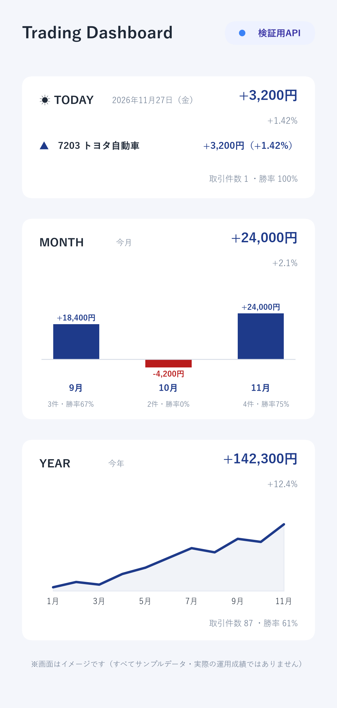
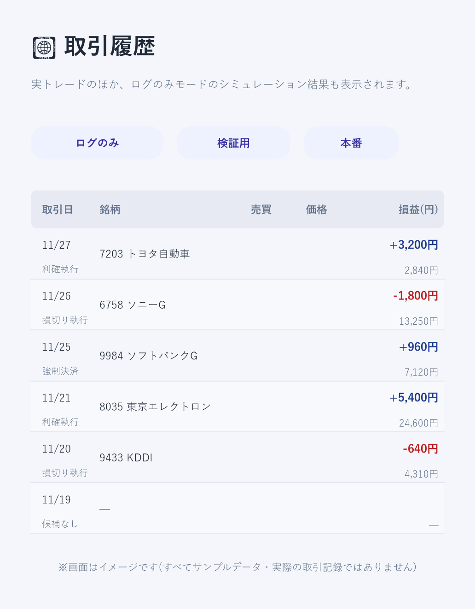
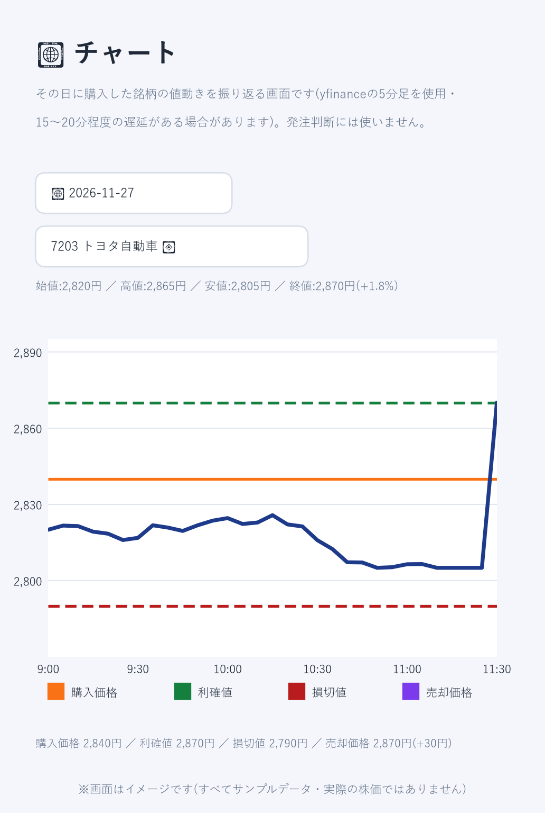
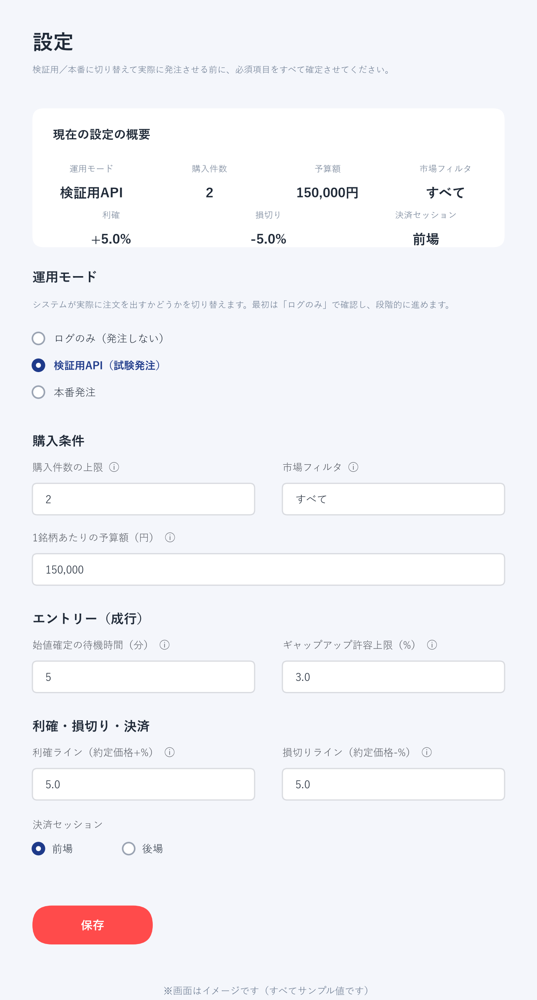

# 【完全自動化】kabuステーションAI自動売買システムの構築手順＆Claude Codeカスタマイズガイド

※タイトル案（他の候補は本ファイル末尾の「題名案」を参照）

（冒頭に目次を箇条書きで入れる。note上でリンクジャンプしない場合がある旨も注記）

- 1. はじめに（無料エリア）
- 2. 仕組みの全体像
- 3. 毎朝の運用はこれだけ
- 4. 【セットアップ】構築手順
- 5. 【応用】Claude Codeで自分好みに改造する手順
- 6. 正直に書いておきたい、現状の制約
- 7. よくあるエラーとトラブルシューティング
- 8. 免責事項・注意事項

---

## 1. はじめに（無料公開エリア）

デイトレは、本来「寄り付き（9:00）の値動きを見て、利益確定・損切りのタイミングを自分の目で
判断し続ける」取引です。会社員をしながらこれをやるのはまず不可能ですし、仮に時間が取れても、
「もう少し待てば戻るかもしれない」「ここまで下がったら逆に買い増ししたい」といった感情が、
機械的なルールより先に判断を乗っ取ってしまうことは珍しくありません。

この記事で紹介するのは、[前回の記事](【要確認：記事①のnote URLを記入】)で作った「毎朝AIが
おすすめ株を教えてくれるアプリ」と連携し、**寄り付きの確認から、新規エントリー、利確・損切り、
前場引けでの強制決済までを、三菱UFJ eスマート証券の「kabuステーションAPI」を使って自動化する
自動売買システム**の構築手順です。


※画面はイメージです（すべてサンプルデータ・実際の運用成績ではありません）


※画面はイメージです（すべてサンプルデータ・実際の取引記録ではありません）


※2026年11月26日の実際の自動売買記録です（4475 HENNGE・前引け前に強制決済）。
過去の実績であり、将来の成果を保証するものではありません


※画面はイメージです（すべてサンプル値です）

毎朝の売買結果は、スマホからこのようなダッシュボードで確認します。本日・今月・今年の
損益と勝率がひと目で分かり、操作が必要な場面はありません。

### 毎朝の運用はこれだけ

実際にこの自動売買システムを動かしたあとの、あなたの1日はこうなります。

- **朝**: パソコンの電源が入っていれば、kabuステーションの起動からログイン（パスキー選択＋
  Windows HelloのPIN入力）まで自動で完了します。PCの前にいる必要はありません
- **日中、会社や外出先で**: スマホでダッシュボードを開けば、本日の売買状況・保有中の建玉・
  損益が確認できます。何か操作する必要はありません
- **決済セッション終了後**: 利確・損切り・強制決済のいずれかで、その日の取引は自動的に
  完結しています。帰宅後、ダッシュボードで結果を振り返るだけです（決済のタイミングは
  設定画面で前場11:10頃／後場15:10頃から選べます。前場のみでの運用を推奨しています）

### この自動売買システムでできること

- 毎朝9:00、おすすめアプリが選んだ銘柄の始値が確定するのを自動で待ち、条件を満たせば**成行で
  自動エントリー**
- 約定後、**利確の指値**と**損切りの逆指値**を自動発注（損切りの逆指値は証券会社のサーバー側で
  管理されるため、このシステムやPCが落ちても生き続けます）
- 利確ラインに到達したら、損切り注文を自動キャンセルして利確の指値に自動で切り替え
- 利確・損切りのどちらも成立しなければ、前場引け前に**自動で成行決済**（持ち越しなし・日計り）
- 毎朝のkabuステーション起動・ログイン（パスキー認証のPIN入力を含む）まで自動化
- ダッシュボードで、本日・今月・今年の損益と勝率をスマホからいつでも確認可能

### 読者が最初に気になるはずのポイント

**①働きながらでもデイトレができます。** 朝、PCの電源さえ入っていれば、あとは放っておいても
ログイン・寄り付きの確認・エントリー・利確/損切り・前場引けの決済まで自動で進みます。日中は
会社の昼休みなどにスマホでダッシュボードを開き、結果を確認するだけで完結します。

**②売買の判断から「感情」を切り離せます。** 損切りのラインは、エントリーの時点で証券会社の
サーバーに逆指値として登録されます。その後に株価がどう動いても、「もう少し待てば戻るかも」
という気持ちが入り込む余地がありません。あらかじめ決めたルールどおりに、淡々と利確・損切りが
執行される——これは裁量トレードでは実現しにくい、自動化ならではの強みです。

ただし後述のとおり、ログイン自動化はWindowsの画面操作を自動化する仕組みのため、OSやkabu
ステーション側のアップデートで動かなくなる可能性はゼロではありません。誇張せずに、できること・
前提として知っておいてほしいことの両方をこの記事でお伝えします。

### 前提として必要なもの

- **[前回の記事](【要確認：記事①のURL】)のアプリ**: おすすめ銘柄の選定元として必要です
  （同じ仕組みを自分で用意済みであることが前提）
- **三菱UFJ eスマート証券の口座**: 現物＋信用取引口座（「デイトレード信用取引」が使えること）
- **kabuステーション**: 三菱UFJ eスマート証券が提供する無料デスクトップアプリ。API機能を含む
- **常時起動できるWindows PC**: kabuステーションは常時起動が必要です。ノートPCでも
  デスクトップでも可ですが、市場が開いている時間帯（9:00〜11:30頃）は起動・ネット接続している
  必要があります
- **GitHub・Supabase・Streamlit Community Cloudのアカウント**: 前回の記事と同じものを
  そのまま使えます

私は、デイトレ専用パソコンを用意して、常時起動しています。

### 作業時間の目安

- **証券口座・信用取引口座の開設**（審査あり）: 数日〜1週間程度（証券会社側の審査期間）
- **kabuステーションのインストール・API有効化**: 30分
  （証券口座の開設からkabuステーションAPIの有効化・パスキー登録までの手順は、
  [【前提知識】三菱UFJ eスマート証券の口座開設から信用取引・kabuステーションAPI・パスキー登録まで](【要確認：記事③のnote URLを記入】)
  を参照してください）
- **アプリのデプロイ・Supabase設定**: 30分
- **設定画面での条件入力・検証モードでの確認**: 1〜2時間
- **Windowsタスクスケジューラ登録**（4つのタスク）: 40〜60分
- **合計（口座審査期間を除く）**: **半日〜1日程度**

> **投資は自己責任です。** この自動売買システムは「あらかじめ決めたルールどおりに自動発注する」仕組みであり、
> 利益が出ることを保証するものではありません。掲載する仕組み・数値は実際の開発・運用の記録を
> もとにしたものですが、過去の動作実績は将来の成果を保証しません。自動売買の対象は**ご自身の
> 口座での自己資金運用のみ**を前提としています（他人の資金を運用する場合や、売買シグナルを
> 第三者に販売する場合は、別途、金融商品取引業の登録が必要になることがあります）。また、
> 証券会社のAPI利用規約（自動売買の条件・発注頻度制限など）は、ご自身で必ず確認してください。

---

ここから先は有料エリアです。Supabaseへのテーブル追加から、kabuステーションAPIの設定、
ログイン自動化・Windowsタスクスケジューラへの登録、実際に貼り付けて使えるコマンド、
つまずきポイントの解決策まで、順を追って説明します。

（ここから有料エリア）

## 2. 仕組みの全体像

平日の時間の流れは、次のようになります。

- **7:00**: 前回の記事のアプリが、おすすめ銘柄を順位付きで選定
- **8:00頃**: 自動売買システムがkabuステーションを自動起動し、ログイン画面で
  「パスキーでログイン」を選択したうえで、Windows HelloのPIN入力まで自動で完了させます
  （PCの前に人がいなくても完了します）
- **9:00〜9:05**: 始値が確定するのを待つ（最大5分。確定しなければその日は発注せず見送り）
- **始値確定後**: 前日終値比のギャップを計算し、許容範囲内なら**成行で新規買い**
  （範囲外ならその日は見送り）
- **約定後**: 実際の約定価格をもとに、利確の指値・損切りの逆指値を自動発注
- **利確ライン到達時**: 損切りの逆指値を自動キャンセルし、利確の指値に切り替え
- **11:10頃（前場引け前）**: 利確・損切りどちらも成立していない建玉を自動で成行決済
  （前場のみで完結・持ち越しなし）
- **夕方**: kabuステーションを自動終了

**なぜ指値ではなく成行でエントリーするのか**: 株の始値は、その日の寄り付き（板寄せ）で
決まるため、寄り付き前に「始値そのもの」を指値として指定することができません。そこで、
「始値が確定するのを待ってから、前日終値との差（ギャップ）が許容範囲内かを判断し、範囲内なら
成行で買う」という、**買う前に条件判定を済ませる**設計にしています。

**利確と損切りを同時に出せない理由（ソフトウェアOCO）**: kabuステーションAPIは、いわゆる
「OCO注文」（利確と損切りをセットで出し、片方が成立したらもう片方は自動キャンセルされる注文）
を公式にはサポートしていません。同一の建玉に対して複数の返済注文を同時に出すこともできません。
そこでこの自動売買システムでは、**損切りの逆指値だけを証券会社のサーバーに先に登録し**（システムが落ちても
守られる状態にする）、別の監視プロセスが株価をポーリングして、利確ラインに到達した瞬間だけ
「損切りをキャンセル→利確の指値を発注」という処理をソフトウェア側で行っています。

## 3. 毎朝の運用はこれだけ

実際にこの自動売買システムを動かしたあとの、あなたの1日はこうなります。

- **朝**: パソコンの電源が入っていれば、kabuステーションの起動からログイン（パスキー選択＋
  Windows HelloのPIN入力）まで自動で完了します。PCの前にいる必要はありません
- **日中、会社や外出先で**: スマホでダッシュボードを開けば、本日の売買状況・保有中の建玉・
  損益が確認できます。何か操作する必要はありません
- **決済セッション終了後**: 利確・損切り・強制決済のいずれかで、その日の取引は自動的に
  完結しています。帰宅後、ダッシュボードで結果を振り返るだけです（決済のタイミングは
  設定画面で前場11:10頃／後場15:10頃から選べます。前場のみでの運用を推奨しています）

損切りのラインは、エントリーの直後に機械的に証券会社へ登録されます。株価がそのラインに
近づいても、このシステムは「待つ」という判断をしません。ここが、感情に左右されやすい裁量トレードとの
最大の違いです。

ダッシュボードのほかに、過去の取引を一覧で振り返る「取引履歴」画面と、その日に購入した
銘柄の値動きを折れ線グラフで振り返る「チャート」画面もあります（画面イメージは
「1. はじめに」を参照してください）。

## 4. 【セットアップ】構築手順

### ① 証券口座を開設する

三菱UFJ eスマート証券（旧auカブコム証券）で、現物取引口座と信用取引口座を開設します。
この記事の自動売買システムは「デイトレード信用取引」（日計り専用・取引手数料無料・金利/貸株料0%の商品）を
前提にしているため、信用取引口座の審査が必要です。審査には数日かかる場合があります。

### ② kabuステーションをインストールし、APIを有効化する

1. 口座開設後、kabuステーション（無料デスクトップアプリ）をダウンロード・インストール
2. kabuステーションの「システム設定 > API」から「APIを利用する」をONにし、**本番用・検証用**の
   それぞれのAPIパスワードを設定する
3. 「暗号化ログを出力する」もONにしておく（障害・誤発注時の調査に役立ちます）
4. 同じ画面で、**ソフトリミット**（1回の注文で発注できる金額の上限）を確認・調整する。
   デフォルトは現物・信用とも300万円に設定されていることが多いため、ご自身の想定投入額に
   見合う額（投入額の3〜5倍程度を目安）まで下げておくことを推奨します。これは、万一システムの
   コードにバグがあっても、証券会社側が機械的に注文を止めてくれる「最後の安全弁」です

### ③ 公開用リポジトリをForkし、Supabaseにテーブルを追加する

公開用リポジトリ: [https://github.com/basel5freedom/daytrade](https://github.com/basel5freedom/daytrade)
（[前回の記事](【要確認：記事①のURL】)のアプリとは別のリポジトリです。Fork自体は前回と同じ
手順のため、詳しくは前回の記事の②を参照してください）

Supabaseは**前回作成したプロジェクトをそのまま使います**（新しく作る必要はありません）。

1. 上記リポジトリのページで「Fork」→「Create fork」を押し、自分のアカウントに複製します
2. 前回作成したSupabaseプロジェクトを開き、左メニューの**「SQL Editor」**を開きます
   （最初から空白のSQL入力欄が表示されます。ボタン操作は不要です）
3. GitHubで今回Forkしたリポジトリを開き、`supabase_schema.sql` というファイルを表示して
   中身をドラッグしてすべて選択し、`Ctrl+C`（Macは`⌘+C`）でコピーします。それをSQL Editorの
   空欄に貼り付けて**「Run」**を押します。**「Run without RLS」「Run and enable RLS」**の
   2択が出た場合はどちらでも構いません（このアプリのスキーマは、テーブル作成後に
   RLSを明示的に無効化する処理を含んでいるため、どちらを選んでも最終的にRLSは無効化
   されます）。これで`daytrade_settings`・`daytrade_trades`の2テーブルが追加されます
   （前回のアプリの`recommendations`テーブルは読み取り専用のままそのまま使います）

### ④ パスワードを設定する

管理画面用のログインパスワードを決めます。前回の記事の⑥-1と同じように、まずターミナルを開き、
③でForkしたリポジトリをクローンします（前回の記事の⑥-3と同じ要領です）。

```
git clone <今回Forkしたリポジトリのクローン用URL>
cd daytrade
python scripts/hash_password.py
```

「パスワードを入力してください」の表示に従って好きなパスワードを入力すると、ハッシュ値
（長い英数字の文字列）が表示されます。これをコピーし、後述の環境変数 `ADMIN_PASSWORD_HASH`
に設定します（ユーザー画面用パスワードは、前回の記事で設定したものと兼用します）。

### ⑤ ローカルで動作確認する（推奨）

前回の記事の⑥と同じ流れです。Git・Pythonのインストールは前回済んでいる前提で進めます
（まだの場合は、前回の記事の⑥-2を参照してインストールしてください）。

まず、設定ファイルをコピーし、このアプリが使うライブラリをインストールします。

```
cp .env.example .env
python -m pip install -r requirements.txt
```

（Windowsで`cp`がうまく動かない場合は、エクスプローラーで`.env.example`をコピーし、
ファイル名を`.env`に変更してください。`pip install`ではなく`python -m pip install`と
するのは、Windows環境でPythonの複数インストールがある場合に、`pip`コマンドが
`python`と異なるインストール先を指してしまうことがあるためです。最後に
`[notice] A new release of pip is available...`という表示が出ても、これは単なる
pip自体の更新案内で無視して問題ありません）

できた`.env`ファイルをメモ帳などのテキストエディタで開き、前回の記事で控えた
`SUPABASE_URL`・`SUPABASE_KEY`と、④で生成したハッシュ値を書き込みます。

```
SUPABASE_URL=（前回の記事で控えたProject URL）
SUPABASE_KEY=（前回の記事で控えたanon publicキー）
ADMIN_PASSWORD_HASH=（④で生成したハッシュ値）
APP_PASSWORD_HASH=（前回の記事で生成したユーザー画面用ハッシュ値と同じもの）
```

保存したら、ブラウザで画面を確認します。

```
python -m streamlit run app.py
```

このPCで初めてStreamlitを実行する場合、`Email:`の入力を求められることがあります。これは
利用統計メールの案内で、**入力せずそのままEnterキーを押して空欄で進めて問題ありません**
（一度だけ表示される案内です）。

`Local URL: http://localhost:8501` のような表示が出て、ブラウザが開きます（開かない場合は
表示されたURLを手でコピーして開いてください）。確認が終わったら、ターミナルで`Ctrl+C`を
押すと停止できます（この時点では実際の発注はまだ設定していないため、安全に確認できます）。

### ⑥ Streamlit Community Cloudにデプロイする

前回の記事の⑦と同じ要領です（前回すでにStreamlitアカウントを作成・GitHub連携済みのため、
初回登録の画面は出ないはずです）。

1. [https://share.streamlit.io](https://share.streamlit.io) にログインし、
   画面右上の**「Create app」**をクリックします
2. 「What would you like to do?」のような選択画面が出た場合は
   **「Deploy a public app from GitHub」**の**「Deploy now」**を選びます
3. 「Deploy an app」の入力画面で、**Repository**に今回Forkしたリポジトリ
   （`daytrade`）を選び、**Branch**は`main`のまま、**Main file path**に`app.py`と
   入力して**「Deploy」**を押します

デプロイ後、[https://share.streamlit.io](https://share.streamlit.io) の「My apps」一覧に
戻り、デプロイしたアプリの行の右端にある**「⋮」**→**「Settings」**→**「Secrets」**を
開きます。前回の記事の⑦と同様、Streamlit側は`.env`とは書き方が違う形式（TOML形式）のため、
値を`"`で囲んで貼り付けてください。

```
SUPABASE_URL = "（前回の記事で控えたProject URL）"
SUPABASE_KEY = "（前回の記事で控えたanon publicキー）"
ADMIN_PASSWORD_HASH = "（④で生成したハッシュ値）"
APP_PASSWORD_HASH = "（前回の記事で生成したユーザー画面用ハッシュ値）"
```

> ⚠️ 「Save changes」を押して**「Internal server error. Please retry...」**と表示される
> ことがあります。Streamlit側の一時的な不具合であることが多いため、少し時間をおいてから
> もう一度「Save changes」を押し直してみてください。

最後に、同じ「App settings」画面の**「Sharing」**タブを開き、**「Who can view this app」**の
プルダウンから**「This app is public and viewable by anyone」**を選んで
**「Save changes」**を押します（限定公開のままだと、スマホなど別セッションからアクセス
できません）。

### ⑦ 設定画面でリスク条件を入力する

デプロイしたアプリにログインし、設定画面で次の項目を自分のリスク許容度に合わせて入力します
（画面イメージは「1. はじめに」を参照してください）。

- 購入件数の上限（まずは1件から始めることを推奨）
- 市場フィルタ（迷ったら「すべて」。前回の記事のアプリ側の対象市場の範囲でしか絞れません）
- 1銘柄あたりの予算額（委託保証金）。**この額 ÷ 想定株価 ÷ 100 が「100株単位で買える上限」に
  なるため、前回の記事で設定した株価範囲と整合する額にしてください**（例: 株価上限4,500円の
  銘柄を100株買うには、最低45万円程度の予算額が必要です）
- 利確ライン・損切りライン（約定価格に対する%。筆者の環境では±5%で運用していますが、
  ご自身のリスク許容度に合わせて調整してください）
- ギャップアップの許容上限（前日終値比。範囲を超えたらその日は見送り）
- 決済セッション（前場11:10頃／後場15:10頃。前場のみでの運用を推奨）

**`mode`（運用モード）は `log_only` → `paper` → `live` の順で段階的に進めてください。**
設定画面は、`mode`を`paper`または`live`に切り替えようとした際、必須項目が1つでも未確定だと
保存をブロックする安全装置を備えています。

1. **`log_only`（ログのみ）**: 実際には発注せず、「このロジックならどう判断したか」をログに
   記録するだけのモード。まず数日このモードで動かし、意図通りの判断をしているか確認します
2. **`paper`（検証用API）**: kabuステーションの検証用APIパスワードを使い、実際の注文コードの
   経路を確認します。ただし検証用環境は「注文形式が正しいか」までしか確認できず、実際の約定は
   シミュレートされません（後述の「現状の制約」参照）
3. **`live`（本番）**: 実際に発注します。**最初は購入件数1件・予算額も小さめから始め**、
   問題がないことを確認しながら段階的に増やしてください

### ⑧ ログイン自動化の設定とWindowsタスクスケジューラへの登録

> ※この自動化は、Windowsのサインイン方法が「PIN」（Windows Hello）になっていることが
> 前提です。現在パスワードでサインインしている場合は、先に「設定 > アカウント >
> サインインオプション」からPINを追加設定してください。

kabuステーションは、三菱UFJ eスマート証券側のシステムメンテナンスにより、**毎朝6:15頃に
強制的にログアウトされます**。この記事の自動売買システムには、毎朝の起動〜ログイン（パスキー選択＋
Windows HelloのPIN入力）までを自動化するスクリプトが含まれています。

まず `.env` に、kabuステーションの実行ファイルパスとWindows HelloのPIN（ログイン用PIN）を
設定します。

```
KABU_STATION_EXE_PATH=（kabuステーションの実行ファイルのフルパス）
KABU_PIN=（あなたのWindows HelloログインPIN）
```

> ⚠️ **`KABU_PIN`はWindowsのログインPINそのものであり、極めて重要な秘密情報です。**
> `.env`は`.gitignore`で管理対象外になっていることを必ず確認し、絶対にリポジトリへ
> コミットしない・スクリーンショットに写さないでください。この記事・サンプルコードにも
> 実際の値は一切含まれていません。

#### Pythonの場所（フルパス）を確認しておく

タスクスケジューラは、ターミナルのように「python」だけでは実行できません。Pythonの
実行ファイルの場所を、フルパスで正確に指定する必要があります。ターミナルで次を実行すると、
その場所が表示されます。

```
where python
```

表示された中の1つ（`C:\Users\あなたの名前\AppData\Local\Programs\Python\Python312\python.exe`
のような形）をメモしておきます。以下の手順で「プログラム/スクリプト」に入力するのは、
この`python`単体ではなく、**このフルパス**です。

#### タスクスケジューラでタスクを作成する

1. キーボードの「Windowsキー」を押し、`タスクスケジューラ` と入力してEnterで起動します
2. 右側の「操作」パネルから「基本タスクの作成」を選びます
3. ウィザードに従い、名前（例: 「kabu自動ログイン」）を入力して「次へ」
4. トリガーの画面で「毎週」を選び「次へ」、曜日は月〜金のみチェックを入れ、時刻は
   「8:00:00」に設定して「次へ」
5. 操作の画面で「プログラムの開始」を選び「次へ」
6. 「プログラム/スクリプト」欄に、上で確認したPythonのフルパスを入力します
7. 「引数の追加」欄に `scripts/auto_login_kabu.py` と入力します
8. 「開始（作業フォルダー）」欄に、③でクローンしたフォルダのフルパス（例:
   `C:\Users\あなたの名前\daytrade`）を入力します。**この項目を
   空欄のままにすると、`.env`ファイルが見つからずエラーになるため、忘れずに入力してください**
9. 「次へ」→「完了」の前に表示される確認画面で、**「完了」を押す前に**いったん
   「このタスクを実行するユーザー アカウントが入力したときに、パスワードを入力するか
   どうかにかかわらず実行する」を選ばず、そのまま「完了」を押します（デフォルトのままでOK）
10. 作成されたタスクをタスクスケジューラの一覧からダブルクリックして開き、「全般」タブで
    **「最上位の特権で実行する」にチェックを入れて「OK」**を押します（画面操作の自動化に
    管理者権限相当の操作が必要なためです。チェックを入れ忘れると、ログインが途中で
    止まってしまいます）
11. 同じ「全般」タブで、「ユーザーがログオンしているかどうかにかかわらず実行する」ではなく
    **「ユーザーがログオンしている場合のみ実行する」が選ばれていることを確認します**
    （紛らわしいのですが、PCの画面がロックされている状態＝「画面はロックされているが
    ユーザーはログオンしたまま」なので、この設定で問題なく動作します。ログオフ＝PCから
    完全にサインアウトしてしまうと動かないため、サインアウトはしないようにしてください）

同じ手順で、以下のタスクも作成します（②③④はすべて手順6〜11を同様に設定してください）。

- **朝のタスク**: 平日8:00頃に `scripts/auto_login_kabu.py` を実行（上で作成したもの）
- **夕方のタスク**: 平日15:30頃に `scripts/close_kabu.py` を実行
- **売買本体のタスク**: 平日の寄り付き前後の時刻に `scripts/run_live_once.py` を実行
- **前引け強制決済のタスク**: 平日11:00頃（前引け11:10より少し前）に
  `scripts/force_close_all.py` を実行

#### 設定後の確認

すべて登録したら、朝の時刻を少し先に設定し直すなどして一度手動で動作させ、タスクスケジューラの
「履歴」タブ、または`logs/`フォルダ内のログファイルを見て、正常に完了している
（エラーが出ていない）ことを確認してください。確認が終わったら、時刻を本来の設定に戻します。

## 5. 【応用】Claude Codeを使って自分好みに改造する手順

ここから先は任意です。4章までの手順で自動売買システム自体は完成しており、設定画面の数値を調整するだけなら
Claude Codeは不要です。コードそのものを変更したい場合のみ進めてください。システム本体は稼働中にAIの
APIを呼び出す設計ではないため、改造を行わない限りAnthropicのアカウントも課金も不要です。
改造する場合は、[前回の記事](【要確認：記事①のURL】)と同じくClaude Codeの利用料
（Claude Pro/Maxなどのサブスクプラン、または従量課金のAPIクレジット）がかかります。

### ① リスク上限を細かく調整したいとき

```
trade/guardrails.md 相当のリスク上限（1銘柄あたりの予算額・利確損切り%・ギャップ許容上限）を、
common/config.py または設定画面（views/settings.py）経由で変更できるようにしたい。
現在の実装を確認した上で、安全に調整できる箇所を教えて。
```

### ② 決済セッション（前場／後場）を切り替えたいとき

設定画面の「決済セッション」を変更すると、利確監視の終了時刻（前場11:10／後場15:10）は
自動で切り替わりますが、**前引け強制決済のタスクスケジューラの起動時刻はアプリからは
変更できません**。決済セッションを後場に変更する場合は、タスクスケジューラの該当タスクの
起動時刻も合わせて手動で変更してください（この点は設定画面にも注意書きがあります）。

### ③ 異常時にスマホへ通知を飛ばしたいとき

```
run_live_once.py や force_close_all.py が異常終了したとき、LINE Notify（または他の通知手段）
にメッセージを送る仕組みを追加したい。既存のログ出力箇所を教えてもらい、通知を追加する
実装案を出して。
```

## 6. 正直に書いておきたい、現状の制約

この自動売買システムは実際に自分の資金で運用しながら改善を重ねてきたものです。誇張せず、現時点で
できていないことも正直にお伝えします。

- **ログイン自動化は、Windowsの画面をスクリプトで操作する仕組みです。** kabuステーションや
  Windows側のアップデートで画面構成・挙動が変わると、動かなくなる可能性があります。その場合は
  手順どおりに動かないだけで、お使いの証券口座・PCが危険にさらされるわけではありません。
  `logs/`のログを見て、ログインが失敗していないか時々確認することをおすすめします
- **1日・週単位の損失上限による自動停止（キルスイッチ）は、現時点では実装していません。**
  「購入件数を1件に絞り、1トレードの損切り%を決めておく」ことで損失が自然に頭打ちになる
  設計に依存しています。想定を超える連続損失が起きた場合、自動では止まらないため、**日中は
  こまめにダッシュボードを確認する**ことをおすすめします
- **Windowsタスクスケジューラの設定が、何らかの理由で無効化されてしまうことが実際にありました。**
  完全に放置するのではなく、「today（本日）の実行ログが残っているか」を日次で軽く確認する
  運用を推奨します
- kabuステーションAPIの仕様は、証券会社側の都合で予告なく変更されることがあります
  （本記事の執筆中にも、発注時の市場コード指定の仕様変更が1件ありました）。手順どおりに
  動かない場合は、kabuステーションAPIの公式ドキュメント・利用規定を確認してください

ログインを含めて日々の発注・決済は無人で完結しますが、**キルスイッチ未実装という1点は、
日中のこまめな確認で補う前提**で運用しています。完全放置というより、「朝の操作は不要・
日中は軽くチェック」という運用に近いとご理解ください。

## 7. よくあるエラーとトラブルシューティング

- **`ModuleNotFoundError: No module named 'supabase'`などのライブラリ不足エラー**:
  `python -m pip install -r requirements.txt`を実行してもこのエラーが再発する場合、
  主な原因は2つ考えられます。
  1. **Windowsの「Long Path（長いパス）」制限**: Windowsの既定設定では260文字を超える
     パスにインストールできず、一部のライブラリ（特に階層の深いパッケージ）のインストールが
     途中で失敗することがあります。管理者権限でPowerShellを開き、次のコマンドを実行して
     パソコンを再起動してから、インストールをやり直してください。
     ```
     New-ItemProperty -Path "HKLM:\SYSTEM\CurrentControlSet\Control\FileSystem" -Name "LongPathsEnabled" -Value 1 -PropertyType DWORD -Force
     ```
  2. **`python`と`pip`が指すインストール先が違う**: Windowsに複数のPythonが入っている場合に
     起こります。常に`python -m pip install ...`の形で実行してください（上記のコマンドは
     すでにこの形になっています）
- **kabuステーションが起動しない／ログインで止まる**: ログイン画面はWindowsの標準部品
  （WebView2）で描画されているため、kabuステーション自体のアップデートで画面構成が変わる
  ことがあります。自動化スクリプトが「パスキーでログイン」のボタンを見つけられない場合は、
  手動でその画面まで進めて、ボタンの位置・表記が変わっていないか確認してください
- **発注時に「株式信用新規の注文は抑止されております」と出る**: 市場コード（Exchange）の
  指定方法に起因するエラーです。本記事のコードでは「9（SOR）」を指定するよう設定済みですが、
  証券会社側の仕様変更で再発する可能性があります。公式APIドキュメントの該当パラメータを
  確認してください
- **検証用（paper）モードで試しても注文が反映されない**: 検証用環境は「注文形式が正しいか」
  までしか確認できず、実際の約定・建玉作成はシミュレートされない仕様です。これは不具合では
  なく仕様上の制限のため、最終確認は本番環境でごく小さい金額から試すほかありません
- **想定より多くの建玉ができてしまった**: 1回の注文が複数の建玉に分かれて約定することが
  あります（例: 200株の注文が100株×2件に分かれる）。本記事のコードはこのケースに対応済み
  ですが、独自に改造した場合はこの可能性を考慮してください
- **祝日・休場日に誤って発注されそうになる**: 休場日判定ライブラリ（`jpholiday`）を使って
  休場日には発注処理に入らないようにしています。年末年始など、祝日法上は祝日でない日も
  ハードコードで除外しています
- **公開後に元のリポジトリ側でバグ修正があったとき**: ③でForkした自分のリポジトリに、
  後から修正を取り込みたい場合は次の手順で反映できます
  1. 自分がForkしたリポジトリ（`github.com/自分のユーザー名/daytrade`）をブラウザで開く
  2. リポジトリ名の下あたりに**「This branch is N commits behind
     basel5freedom/daytrade:main.」**という表示と**「Sync fork」**ボタンが出ていたら
     クリックする
  3. **「Update branch」**をクリックすると、元のリポジトリの最新コミットが反映される
  4. Streamlit Community Cloudがこのリポジトリのmainブランチを監視しているため、
     反映後は自動的に再デプロイされます（数分程度かかることがあります）
  - 「5. 【応用】Claude Codeを使って自分好みに改造する手順」を使ってapp.pyなどを
    改造済みの場合、同じ箇所を元のリポジトリ側も修正していると「Sync fork」がコンフリクトに
    なることがあります。その場合は、エラー内容を見て手動で該当箇所を直すか、Claude Codeに
    コンフリクトの内容を貼り付けて解決してもらってください

## 8. 免責事項・注意事項

- **投資は自己責任です。** 本自動売買システム・本記事で紹介する仕組みは、あらかじめ決めたルールに沿って
  自動的に売買を行うものであり、利益が出ることを保証するものではありません
- **掲載する数値・実績は過去のものであり、将来の成果を保証しません。** バックテストや、
  筆者自身の運用実績を「見込み」として読まないでください。実際の運用では、想定損失を超える
  損失が発生したこともあります
- **対象は、あくまでご自身の口座での自動売買のみです。** 他人の資金を運用したり、売買の
  シグナルを第三者に販売したりする場合は、別途、金融商品取引業（投資助言・代理業、投資運用業
  など）の登録が必要になる場合があります
- **本記事で配布する自動売買コードは自己責任でご利用ください。** 利用にあたっては、
  三菱UFJ eスマート証券が定める「kabuステーションAPI利用規約」に従ってご利用いただく
  必要があります。自動売買の条件・発注頻度の制限なども同規約に定められているため、
  必ずご自身で最新の内容をご確認ください。規約は予告なく変更されることがあります
- **動作環境・想定コスト**: 平日の市場時間帯（9:00〜11:30頃）に起動し続けられるWindows PC
  （常時起動）、安定したインターネット回線が必要です。Supabase・Streamlit Community Cloud・
  GitHub Actionsはいずれも無料プランの範囲を前提にしていますが、取引量やデータ量によっては
  有料プランへの移行が必要になる場合があります
- **APIキー・口座情報・パスワードは、本記事・スクリーンショット・サンプルコードのいずれにも
  含まれていません。** ご自身の`.env`ファイル等で管理し、絶対にリポジトリにコミットしないで
  ください
- 動作保証・個別サポートは行いません。証券会社側の仕様変更により、本記事の手順が将来
  通用しなくなる可能性があります
- データのバックアップ: 売買履歴・設定はSupabase側に保存されます。自動バックアップは
  行われないため、重要な記録はご自身で定期的にエクスポートすることをおすすめします

---

## 題名案（ご確認ください）

1. 【完全自動化】kabuステーションAI自動売買システムの構築手順＆Claude Codeカスタマイズガイド
   （既存シリーズの命名規則を踏襲）
2. 働きながらデイトレ——感情を排除する自動売買システムの作り方（kabuステーションAPI）
   （ご指定の「仕事していてもできる」「感情の排除」を題名に直接反映）
3. パソコンをつけておくだけ。スマホで結果を見るだけの自動デイトレシステム構築ガイド

ログイン（パスキー選択＋PIN入力）まで無人化できているため、案1の「完全自動化」は実態と
一致しています。案2・3は、ご指定の「仕事していてもできる」「感情の排除」のベネフィットを
題名で前面に出す方向性です。
